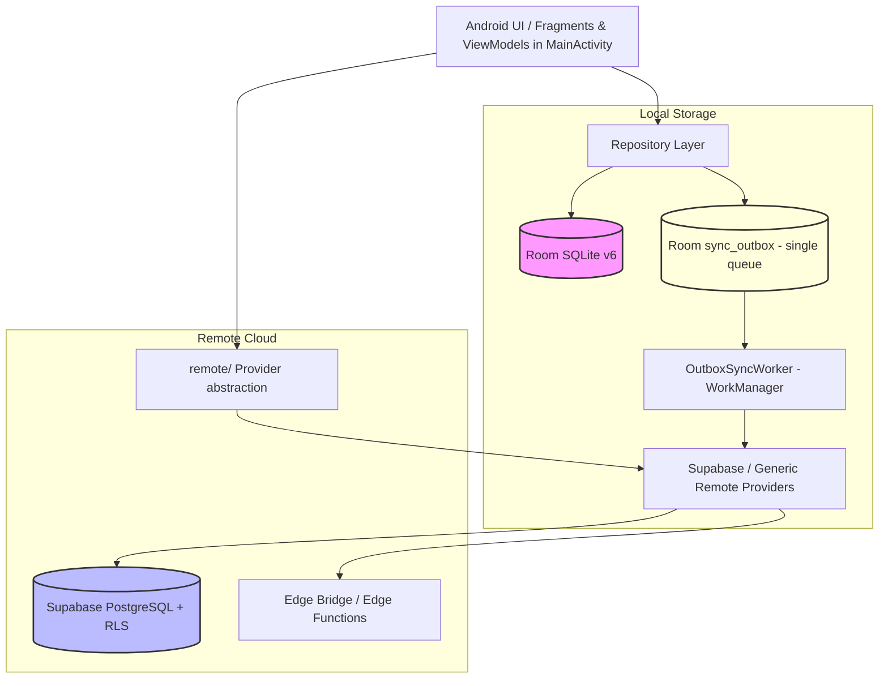
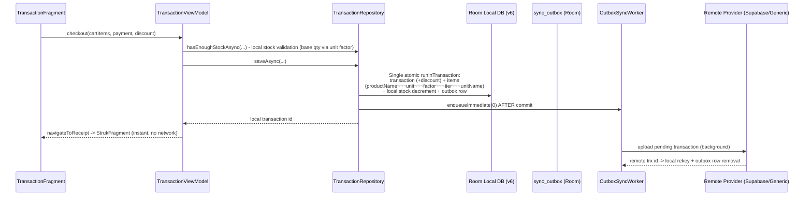
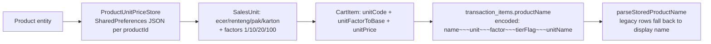

# ARCHITECTURE.md

This document describes the technical architecture of **DasPos (DasPos RW / Retail & Wholesale)**, an Android Point of Sale application with an Offline-First design and Supabase cloud synchronization, built for retail/wholesale operations that must stay reliable online and offline.

> This document mirrors the structure of `daspos_min/ARCHITECTURE.md` but reflects the RW variant, which is a **feature-richer fork** of the minimum edition (tiered wholesale pricing, transaction discounts, manual cart items, multi-provider remote UI, and a larger outbox payload).

---

## 1. Technology Stack

*   **Language**: Java 17 (StrictMode in debug, immutability conventions).
*   **Android Platform**:
    *   `minSdk 22`, `targetSdk 34`, `compileSdk 34` (Android Gradle Plugin 8.x, Gradle Wrapper).
    *   UI: Android Views, **single-Activity + Fragment navigation** — all post-login screens are `Fragment`s hosted by `MainActivity` via `FragmentManager` (`replace` + `addToBackStack`). Remaining Activities are boundaries only: `SplashActivity`, `LoginActivity`, `RegisterActivity`, `SelectDatabaseActivity`, `BluetoothScanActivity` (result via `startActivityForResult`), and `MainActivity`. Material Design Components.
    *   Architecture Components: `ViewModel`, `LiveData`, `SavedStateHandle`. ViewModels are scoped to `requireActivity()` so cart/UI state survives fragment switches and rotation. Shared ViewModel helpers live in `com.daspos.viewmodel` (`ViewModelFactoryHelper`).
*   **Local Storage**:
    *   **Room Database v2.6.1**, schema **version 6** (entities: `OutboxEntity`, `ProductEntity`, `UserEntity`, `TransactionEntity`, `TransactionItemEntity`; schema export enabled under `app/schemas`).
    *   Migrations defined in `AppDatabase`: `MIGRATION_1_2` … `MIGRATION_5_6` (see §5.D for the folded migration map).
    *   **EncryptedSharedPreferences** (`androidx.security:security-crypto:1.1.0-alpha06`) via `SecurePrefs`, with automatic plain-prefs fallback when the Keystore is unavailable (see §5.E for the upgrade caveat).
*   **Cloud Backend**:
    *   **Supabase** (PostgreSQL + RLS + Edge Functions) — a **different Supabase project** than `daspos_min`; URL/anon key come from `BuildConfig.SUPABASE_URL`/`SUPABASE_ANON_KEY` (gradle properties) with runtime override via `SupabaseConfig`.
    *   **Multi-provider remote abstraction**: besides Supabase, the app supports generic remote providers (Firebase, Appwrite, PocketBase, Custom API) selected via a provider spinner in `SelectDatabaseActivity`; see `remote/RemoteDataProviderFactory`, `remote/GenericRemoteDataProvider`, `remote/SupabaseRemoteDataProvider`, `remote/RemoteProviderConfigStore`, and `remote/RemoteAuthBridgeService` (connection test goes through an edge bridge — see `docs/REMOTE_PROVIDER_EDGE_BRIDGE.md`).
*   **External Libraries & Testing**:
    *   Apache POI for Android (`com.github.SUPERCILEX.poi-android:poi:3.17`) for Excel/PDF report export.
    *   JUnit 4.13.2, Robolectric 4.12.2, AndroidX Test, Room Testing.

---

## 2. Directory Map & Module Responsibilities

Source root: `app/src/main/java/com/daspos/`

```text
com.daspos/
├── DasPosApp.java                  # Application class (lazy init + NetworkCallback sync trigger)
├── core/app/                       # Core Activities & Fragments (MainActivity host, HomeFragment,
│                                   #   BestSellerFragment, SplashActivity, BaseActivity)
├── db/                             # Room Database, Converters, Mapper, Migration helper, DAOs
│   ├── dao/                        # OutboxDao, ProductDao, TransactionDao, UserDao
│   ├── entity/                     # OutboxEntity, ProductEntity, UserEntity,
│   │                               #   TransactionEntity, TransactionItemEntity
│   └── model/                      # DB-facing read models (TransactionWithItems)
├── feature/                        # Functional feature modules (Fragment + ViewModel per domain)
│   ├── auth/                       # AuthSessionStore, Login/Register, MenuAccessGuard/Store
│   ├── printer/                    # Bluetooth/network ESC/POS printing (scan, helpers, config)
│   ├── product/                    # Product CRUD, tiered pricing form, CSV/Excel import
│   ├── transaction/                # POS cart, checkout, discount, unit switching,
│   │                               #   manual items, StrukFragment (receipt), print helper
│   ├── user/                       # Cashier/user management
│   ├── report/                     # Reports, export, ReportUiState
│   └── settings/                   # Settings, backup/restore, store config, receipt config,
│                                   #   SelectDatabaseActivity (provider + Supabase setup)
├── model/                          # Domain POJOs (Product, CartItem, SalesUnit, TransactionRecord,
│                                   #   ReportItem, BestSellerItem, User)
├── remote/                         # Remote provider abstraction (RemoteDataProvider interface,
│                                   #   factory, Supabase + Generic implementations, config store)
├── repository/                     # Repository layer & sync engine
│   │                               #   (OutboxStore facade, OutboxSyncWorker/Scheduler,
│   │                               #    ProductUnitPriceStore, TransactionRepository,
│   │                               #    ProductRepository, UserRepository, PendingSyncStore legacy)
│   └── legacy/                     # Legacy seed/migration repositories
├── supabase/                       # Supabase-specific client (HTTP, Auth, SessionRefresher,
│                                   #   Product/Transaction/Outlet services, Config)
├── ui/                             # UI state renderers & common helpers
│   └── state/                      # UiState classes (TransactionScreenState, ListUiState,
│                                   #   ReportUiState, FormUiEffect, ConsumableEvent, ValidationState)
├── viewmodel/                      # Shared ViewModel helpers (ViewModelFactoryHelper)
└── shared/util/                    # Cross-module helpers (CurrencyUtils, FormValidator,
                                    #   ImageDecodeHelper, DbExecutor, SecurePrefs, NetworkUtils,
                                    #   PasswordHasher, ThemeManager, RestoreStateStore, etc.)
```

### Module Responsibilities

1.  **`db/`**: All local persistence via Room/SQLite — schema v6, entities, DAOs, `RoomMapper`, `RoomConverters`, and `RoomMigrationHelper` (one-time seed from legacy storage). `db/model/TransactionWithItems` is the read model joining a transaction with its items.
2.  **`repository/`**: Mediates between ViewModels and data sources (local Room + remote providers). Owns the **single durable outbox** — the Room `sync_outbox` table (`OutboxEntity`/`OutboxDao`) — drained by `OutboxSyncWorker` (WorkManager) scheduled via `OutboxSyncScheduler`. `OutboxStore` is a static facade over `OutboxDao` exposing both context-level methods (own `DbExecutor.runBlocking` + post-commit scheduling) and `*InTransaction` primitives for atomic multi-writes inside `db.runInTransaction`. Legacy SharedPreferences `pending_sync` data is migrated into Room **exactly once** on first outbox access (`ensureLegacyMigrated`, guarded by `migrated_to_room_outbox_v1`).
3.  **`supabase/`**: HTTP client, auth handler, session refresher, and REST/RPC services specific to Supabase. `SupabaseConfig` resolves URL/anon key (BuildConfig defaults → SecurePrefs runtime override) and enforces HTTPS-only remote URLs (HTTP allowed only for loopback dev).
4.  **`remote/`**: Provider-agnostic remote layer. `SelectDatabaseActivity` keeps a **provider spinner** (Supabase / Firebase / Appwrite / PocketBase / Custom API); non-Supabase providers go through `GenericRemoteDataProvider` + `RemoteProviderConfigStore` and are connection-tested via the edge bridge.
5.  **`feature/*/`**: UI logic grouped by business domain. `feature/transaction` is the richest module: tiered unit pricing in cart, transaction-level discount, manual (non-catalog) cart items, per-line unit switching, and receipt printing.
6.  **`shared/util/`**: Cross-cutting helpers — `DbExecutor` (segregated thread pools, §7), `SecurePrefs` (cached EncryptedSharedPreferences), `CurrencyUtils`, `PasswordHasher`, `NetworkUtils`, `RestoreStateStore`, etc.

---

## 3. Data-Flow Diagrams (Mermaid)

### A. Overall System Architecture (Offline-First Sync)



### B. POS Checkout Flow (True Local-First, with discount & unit metadata)



### C. Tiered Pricing Resolution (RW-specific)



---

## 4. Design Patterns

1.  **Repository Pattern**: Decouples ViewModels from data sources (local Room + remote providers), letting the app run transparently online or offline.
2.  **MVVM**: Per feature (`TransactionViewModel`, `ProductViewModel`, `UserViewModel`, `ReportViewModel`, `ProductFormViewModel`, `EditUserViewModel`); UI state rendered via `com.daspos.ui.state` UiState classes and `UiStateRenderer`.
3.  **DAO Pattern**: Type-safe SQLite access via Room (`@Dao`, `@Query`, `@Insert`), including `TransactionWithItems` relational reads.
4.  **Factory & Strategy**: `RemoteDataProviderFactory` selects/initializes the remote provider (Supabase vs. generic); `SalesUnit` centralizes unit-code normalization/default factors.
5.  **Singleton**: `AppDatabase.getInstance`, `SecurePrefs` (per-name `EncryptedSharedPreferences` cache), `SupabaseConfig`. `OutboxStore` is a static facade — facade methods are **not** `synchronized` (Room/SQLite serializes); only the one-time legacy migration uses a dedicated `MIGRATION_LOCK` (deliberately *not* the class monitor to avoid deadlock with `DbExecutor.runBlocking`).
6.  **Idempotent Queue / Outbox Pattern**: `sync_outbox` Room table is the only durable queue; SharedPreferences `pending_sync` is a one-time migration source only. Product ops carry delete-then-merge semantics (a `delete` cancels a pending `add`; an `update` after `add` is promoted to `add`). Retry uses exponential backoff via `nextRetryAt` (`computeNextRetryAt`, base 2s, cap 5 min). Drain triggered by WorkManager (15-min periodic + instant `enqueueImmediate`).
7.  **Encodable Value Object (RW-specific)**: unit/tier metadata for transaction lines is serialized into `transaction_items.productName` using the `~~~` separator (`name~~~unitCode~~~factorToBase~~~tierEnabled~~~unitName`); `parseStoredProductName` tolerates legacy rows without the suffix.

---

## 5. Developer Notes

### A. Prerequisites

*   **Android Studio** (latest stable supporting AGP 8.x).
*   **JDK 17**.
*   **Gradle Wrapper** (`./gradlew`).

### B. Build & Test

```powershell
./gradlew testDebugUnitTest   # unit + migration tests
./gradlew assembleDebug       # debug APK
```

### C. Supabase Setup

Deploy the RW schema per `docs/SUPABASE_MIGRATION_RUNBOOK.md` / `docs/SUPABASE_APP_SETUP.md` and the ordered scripts in `supabase/` (see §5.D for the directory caveats and the `07_` prefix collision).

### D. `supabase/` Directory — RW vs. Min Divergence

The RW `supabase/` directory contains **both RW-only and min-only migration files**, and the two apps share Supabase filename numbering with **different contents**:

| File | Origin |
|------|--------|
| `01_schema.sql`, `02_migration_staging.sql`, `03_rpc_create_transaction.sql`, `04_auth_profile_hardening.sql`, `05_outlets_business_fields.sql`, `09_void_pos_transaction.sql`, `10_purge_outlet.sql`, `11_kasir_product_write.sql`, `12_product_name_unique.sql` | shared lineage |
| `08_adjust_product_stock.sql` | **min-only** (stock adjustment RPC) |
| `06_product_tier_fields.sql` | **RW-only** (tiered pricing columns) |
| `07_product_rw_fields_discount.sql` | **RW-only** (barcode/unit_name/cost_price/track_stock, transactions.discount, discount-aware `create_pos_transaction` RPC) |
| `csv_230426/` (dir) | **RW-only** product CSV seed data |
| `migration_batch_230426.sql` | **RW-only** batch migration |
| `functions/` | Edge Functions (shared layout) |

> ⚠️ When porting docs or runbooks between `daspos_min` and `daspos_rw`, never copy `supabase/` file lists verbatim — verify each file against the target repo.

### E. SecurePrefs & Upgrade Caveat

`SecurePrefs.get(context, name)` returns cached `EncryptedSharedPreferences` (AES256-SIV keys / AES256-GCM values, `MasterKey` AES256_GCM) per prefs name, falling back to **plain** `SharedPreferences` only if Keystore init throws.

**Important for upgrades**: credentials/session material stored by older builds is **not** plaintext-migrated into the encrypted store — on upgrade to the encrypted-prefs build, users must **re-run setup** (re-enter Supabase config / re-login) rather than expecting stored secrets to carry over. This is a deliberate security decision; do not add silent plaintext→encrypted migration without a dedicated PRD.

### F. Legacy `pending_sync` Migration

`PendingSyncStore.java` still exists in `repository/` but is now **dead write-path code kept for reference/parity** — nothing outside `OutboxStore`'s javadoc references it. The live path is: any access to `OutboxStore` first calls `ensureLegacyMigrated(context)`, which copies `pending_sync.pending_transaction_ids` and `pending_sync.pending_product_ops` JSON into `sync_outbox` rows (product payloads stored **verbatim** so all 16 retail fields survive), then removes the keys and sets `migrated_to_room_outbox_v1`. The class can be deleted once the migration window has passed.

---

## 6. Synchronization Strategy

Same proven strategy as `daspos_min` (post-profiling on a Xiaomi MI 8 Lite), with RW deltas noted:

### A. Lazy Startup (`DasPosApp.onCreate`)

`AppDatabase.getInstance()`, `RoomMigrationHelper.seedFromLegacyStorageIfNeeded`, and initial sync triggers all run inside one `DbExecutor.runAsync(...)` — no Room/disk I/O on the main thread. `OutboxSyncScheduler.schedulePeriodic(this)` is scheduled immediately.

### B. Incremental-First Transaction Sync (`TransactionRepository`)

- Routine refresh uses `RemoteDataProvider.getTransactionsSince(...)` + `upsertLocalTransactions(...)` — writes only new/changed rows, **not** wipe-and-rewrite.
- *Full reconcile* (`getAllTransactions` + `replaceLocalTransactionCache`) remains as fallback, gated to **max 1x per 30 minutes** (`FULL_RECONCILE_INTERVAL_MS`, prefs `transactions_last_full_reconcile`) or when the local cache is empty.
- `getLast()` uses `getLastTransaction()` (`ORDER BY timestamp DESC LIMIT 1`) + `getItemsByTransactionId()` — O(1) rows.

### C. Event-Based Sync Triggers (`DasPosApp` + `OutboxSyncScheduler`)

- **`ConnectivityManager.NetworkCallback`** registered once in `DasPosApp` (API 24+): `onAvailable` enqueues `OutboxSyncScheduler.enqueueImmediate` + repository refreshes on `DbExecutor`. `registerDefaultNetworkCallback` also delivers the initial state, so an app started online syncs immediately.
- **Periodic WorkManager request (15 min, `NetworkType.CONNECTED`)** as fallback; previously dead code, now enabled via `schedulePeriodic`.
- **Post-checkout**: `TransactionRepository.save()` calls `enqueueImmediate` after commit.
- Sync checks are **not** in `Activity.onStart()` — no per-screen-transition prefs/network reads.
- On API < 24 (minSdk 22) only the periodic fallback applies.

### D. Centralized 401 Retry (`SupabaseAuthService`)

`sendAuthenticatedRequest(...)` is the shared HTTP plumbing for user-token requests: on HTTP 401 it calls `SupabaseSessionRefresher.refreshAccessToken()` and retries **once** with the new token (`allowTokenRefresh` guard prevents loops). Same pattern on `SupabaseOutletService.patchOutlet`. Auth methods (login/signup/refresh) are intentionally unchanged — there a 401 means invalid credentials.

### E. RW-Specific Sync Payload

`OutboxStore.ProductSyncOp` carries **16 fields** (vs. min's smaller set): `op`, `id`, `name`, `barcode`, `price`, `costPrice`, `stock`, `unitName`, `trackStock`, `priceEcer`, `priceRenteng`, `pricePak`, `priceKarton`, `factorRenteng`, `factorPak`, `factorKarton` — plus `attemptCount`/`nextRetryAt` populated from the outbox row when reading due ops. `toJson`/`fromOutboxEntity` tolerate payloads written by the older minimal format (missing `barcode`/unit/tier keys) with sane defaults (`unit_name="pcs"`, `track_stock=true`, factors 10/20/100). `price_ecer` doubles as the legacy `price` fallback.

---

## 7. Thread Execution Model & Performance Optimizations

### A. `DbExecutor` — Segregated Pools & `ON_DB_THREAD`

Three separate pools:
- `DB_IO` (2–4 threads): all Room/local access.
- `NETWORK_IO` (4–6 threads): Supabase/remote HTTP.
- `EXPORT_COMPUTE`: heavy computation (Apache POI).

`runBlocking` from a non-DB thread submits to `DB_IO` and blocks the caller. The `ON_DB_THREAD` ThreadLocal prevents nested `runBlocking` from occupying a second pool slot (deadlock) — tasks already on `DB_IO` run `runBlocking` inline. Tasks on `NETWORK_IO`/`EXPORT_COMPUTE` do **not** get the flag, so `runBlocking` inside them still hops to `DB_IO` — Room access never happens concurrently outside the DB pool.

### B. HTTP Must Not Occupy the DB Pool

`OutboxSyncWorker` (`flushPendingTransactionsForWorker`, `flushPendingProductOpsForWorker`) runs upload HTTP **directly on the worker thread**, not inside `DbExecutor.runBlocking`; Room access inside still goes through `runBlocking` → `DB_IO`. All background refreshes (`replaceLocalTransactionCache`, `upsertLocalTransactions`, `replaceLocalProductCache`, etc.) wrap their Room work in `DbExecutor.runBlocking` so it always lands on `DB_IO` even when invoked from a network thread.

### C. `SecurePrefs` — Cached `EncryptedSharedPreferences`

Previously every `get()` built a new `MasterKey` + `EncryptedSharedPreferences`; `MasterKey.Builder.build()` goes through Tink's `AndroidKeysetManager` (disk I/O + crypto behind one global lock), so constant token/outlet reads queued hundreds of ms across threads. Instances are now cached per prefs name (`ConcurrentHashMap`); the keyset is built once per process.

### D. `OutboxStore` Without a Global Monitor

Facade methods are non-`synchronized`; atomicity is guaranteed by Room per-statement and `db.runInTransaction` for multi-writes (e.g. `replaceProductOps`). The only remaining synchronization is `MIGRATION_LOCK` for the one-time SharedPreferences→Room migration — intentionally a separate monitor so it cannot deadlock against `DbExecutor.runBlocking`.

### E. Lighter Cache Replace

`replaceLocalTransactionCache` no longer holds the SQLite write lock while reading all `transaction_items` + building the map: the items read phase runs **outside** `runInTransaction`, and pending outbox rows are re-fetched **inside** the transaction via `getPendingTransactionIds(db)` + `getItemsByTransactionId(...)` per id — so a checkout committing between the two phases is not deleted.

### F. Self-Healing Dashboard

Optimized dashboard methods (`getTodayIncomeOptimized`, `getIncomeByPeriodOptimized`, `getBestSellerItemsOptimized`, `getReportItemsByPeriodOptimized`, `getReportPageOptimized`, `getTodayCountOptimized`) call `triggerTransactionsBackgroundRefresh(context, false)` (20 s throttle + in-flight flag) before reading Room — report/best-seller/home-stat screens no longer depend on other screens to populate the cache.

### G. RW-Specific Notes

- `transaction_items.productName` stores the `name~~~unit~~~factor~~~tier~~~unitName` encoding; any new code writing transaction items **must** go through `toStoredProductName`/`parseStoredProductName` (or `BackupRestoreHelper`'s equivalent encoder) to keep receipts, best-seller, and restore paths consistent.
- `ProductUnitPriceStore` (SharedPreferences JSON keyed by productId) is the local source of truth for tier prices/factors when the product row lacks them; `SalesUnit.defaultFactor` supplies fallback factors (10/20/100).
- Manual cart items are synthetic `Product`s with an empty id — they never hit the catalog or outbox product ops.
